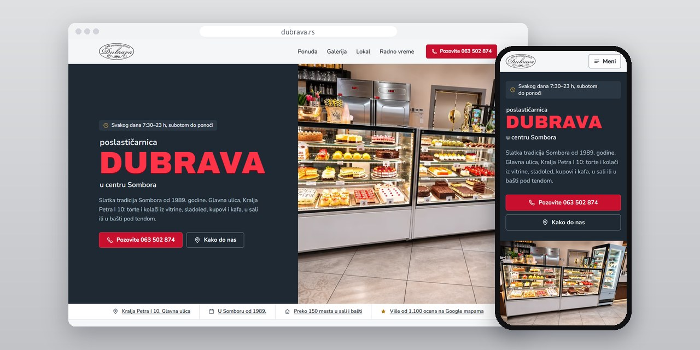
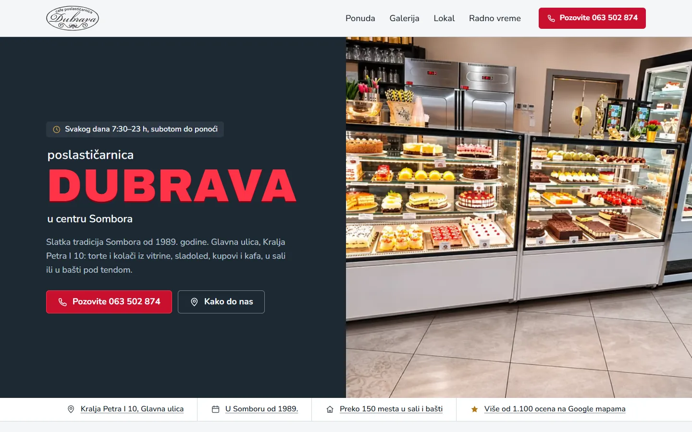
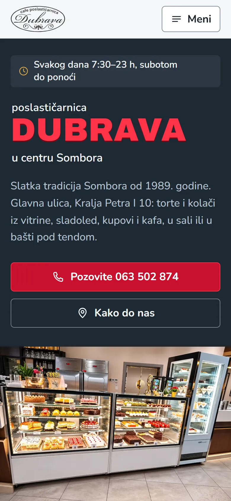
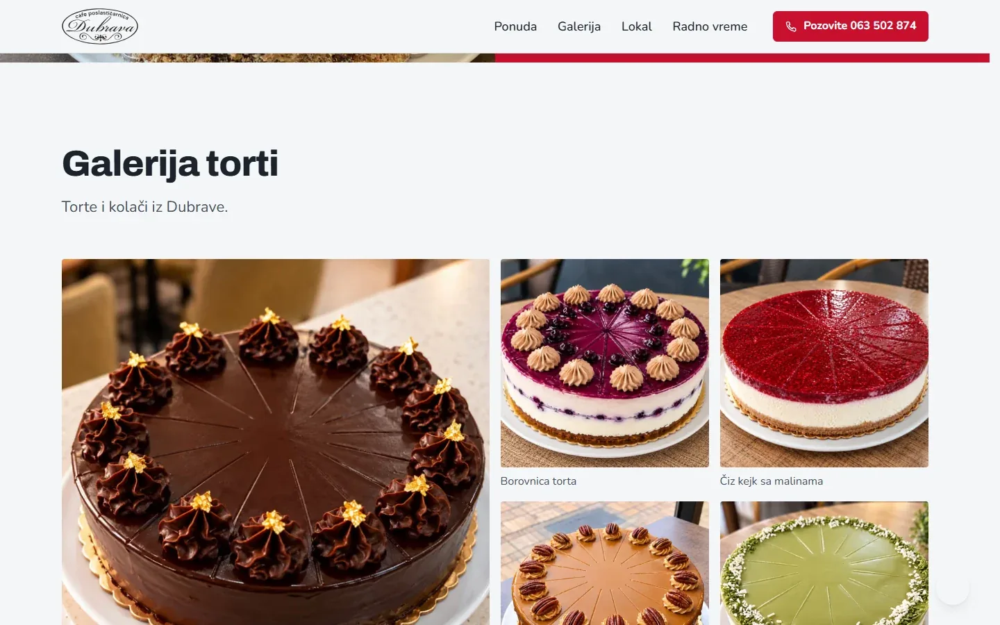
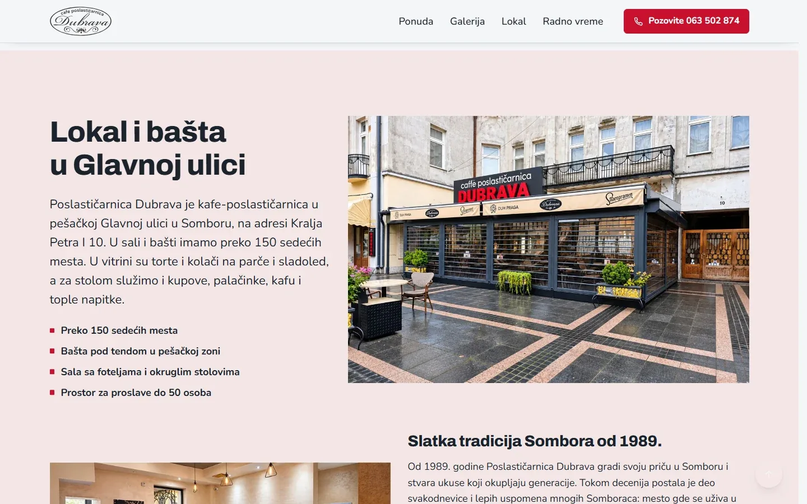

# Poslastičarnica Dubrava

The first website of a pastry shop on the pedestrian main street of Sombor, open since 1989, with a gallery of 25 cakes and orders by phone.

**[dubrava.rs](https://dubrava.rs/)** · [Case study](https://svilenkovic.com/portfolio/dubrava-sombor) · [Srpski](README.sr.md)

> [!NOTE]
> Client project. The source code belongs to the client and stays in a private repository. This page describes what I built and how.

<table>
  <tr><td><b>Client</b></td><td>Poslastičarnica Dubrava</td></tr>
  <tr><td><b>Industry</b></td><td>Pastry shop and café with a garden</td></tr>
  <tr><td><b>Location</b></td><td>Sombor, Serbia</td></tr>
  <tr><td><b>Type</b></td><td>One-page website</td></tr>
  <tr><td><b>My role</b></td><td>Design, development, SEO and hosting</td></tr>
  <tr><td><b>Stack</b></td><td>Astro, TypeScript, WebP, nginx, JSON-LD</td></tr>
</table>

## About the project

Poslastičarnica Dubrava has been on the pedestrian Glavna Street in Sombor since 1989, with more than 150 seats in the hall and in a garden under an awning. It had never had a website. Guests usually come with one of four questions: what is in the display case, how to order a cake, where the place is and whether it is open, so I put the answers on a single page.

Cakes are ordered by phone or in person, so the site has no cart and no order form. The number is in the header, the opening section, the cakes section and the footer, and on phones a bar at the bottom of the screen offers a call and directions. The Google map loads only after a click, with a note that Google then receives the visitor's IP address, and visitor analytics runs only if the visitor turns it on in the cookie banner.

## What I built

- One page with the menu, cake orders, a gallery, the venue, opening hours and seven frequently asked questions
- A gallery of 25 cakes from the shop's own photos, each with its name, and an enlarged view with previous and next buttons
- A section about the hall and the garden, with guests' faces blurred before publishing
- A bar with a call button and directions at the bottom of the screen on phones
- A Google map that loads only on click, and analytics only after consent
- Structured data for a pastry shop, café and ice cream shop, with opening hours for each day and the FAQ

## Results

| | Performance | Accessibility | Best practices | SEO |
| :-- | :-: | :-: | :-: | :-: |
| Mobile | 100 | 100 | 100 | 100 |
| Desktop | 100 | 100 | 100 | 100 |

PageSpeed Insights, lab test of the live site, November 2026. Security headers: 6 of 6. HTML validator: no errors. axe accessibility check: no violations. Structured data: `Bakery`, `CafeOrCoffeeShop`, `FAQPage`, `IceCreamShop`.

## Screenshots

<table>
  <tr>
    <td width="68%" valign="top"></td>
    <td width="32%" valign="top"></td>
  </tr>
</table>

Gallery of 25 cakes with their names and an enlarged view on click

The venue and the garden: more than 150 seats, the hall, the garden under an awning and space for celebrations of up to 50 people

---

Built by [D. Svilenković](https://svilenkovic.com).
