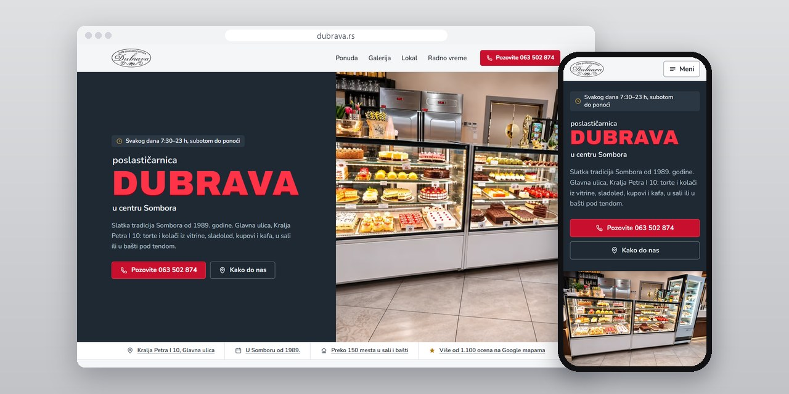
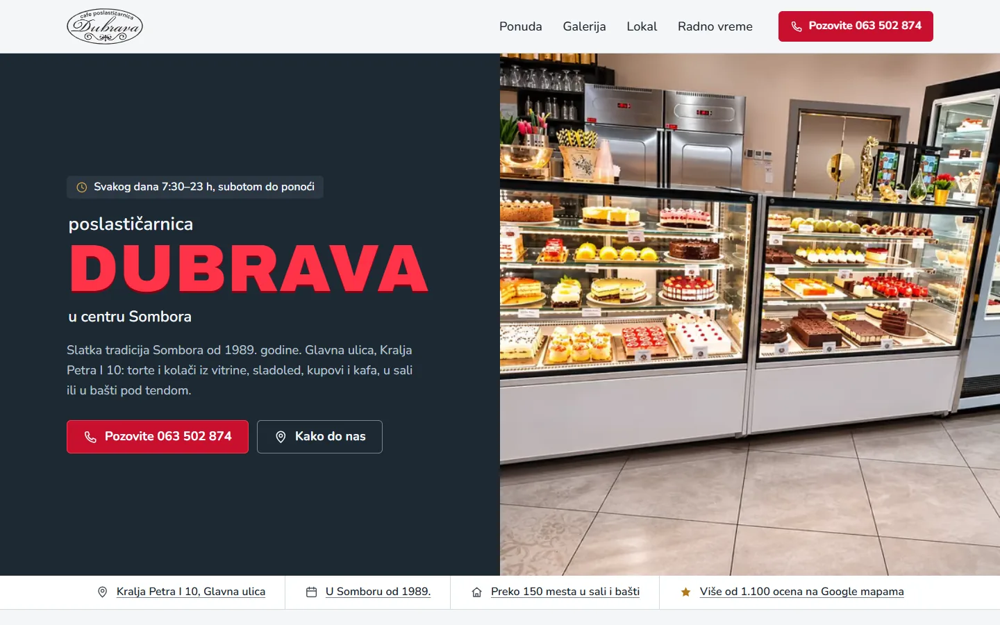
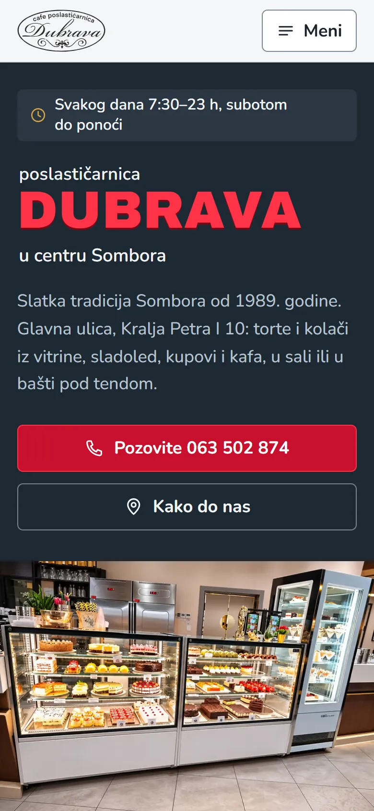
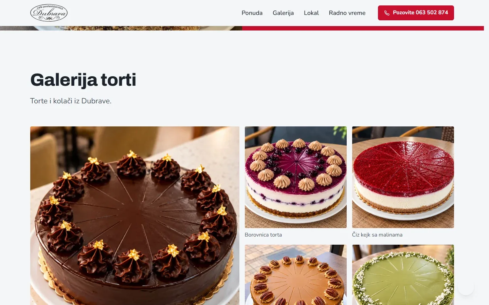
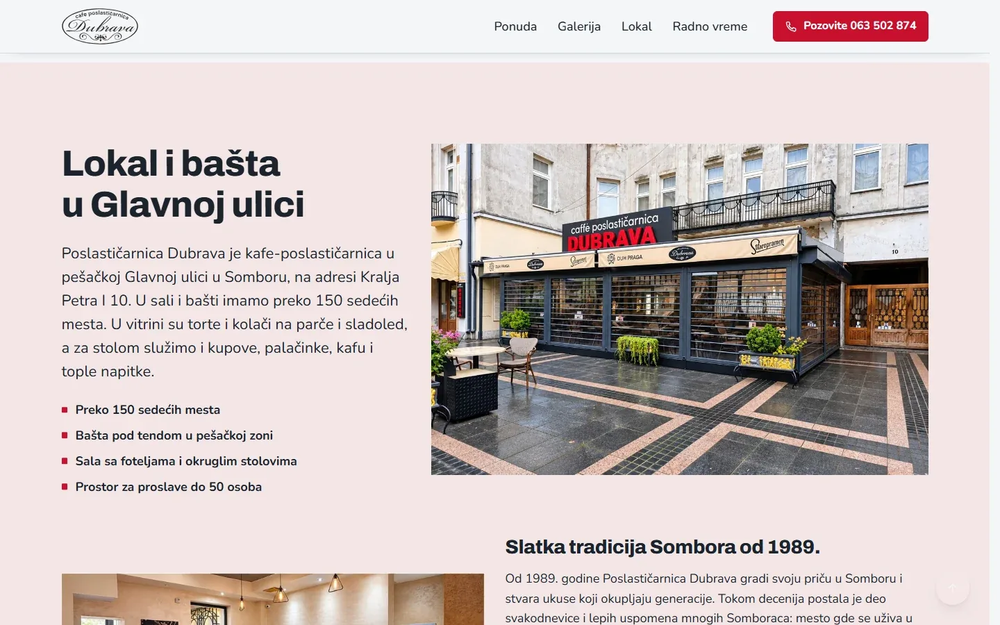

# Poslastičarnica Dubrava

Prvi sajt poslastičarnice u pešačkoj Glavnoj ulici u Somboru, koja radi od 1989, sa galerijom od 25 torti i porudžbinom telefonom.

**[dubrava.rs](https://dubrava.rs/)** · [Studija slučaja](https://svilenkovic.rs/radovi/dubrava-sombor) · [English](README.md)

> [!NOTE]
> Klijentski projekat. Izvorni kod pripada klijentu i čuva se u privatnom repozitorijumu. Ova stranica opisuje šta sam uradio i kako.

<table>
  <tr><td><b>Klijent</b></td><td>Poslastičarnica Dubrava</td></tr>
  <tr><td><b>Delatnost</b></td><td>Poslastičarnica i kafe sa baštom</td></tr>
  <tr><td><b>Lokacija</b></td><td>Sombor</td></tr>
  <tr><td><b>Vrsta</b></td><td>Sajt na jednoj strani</td></tr>
  <tr><td><b>Moj deo posla</b></td><td>Dizajn, izrada, SEO i hosting</td></tr>
  <tr><td><b>Tehnologije</b></td><td>Astro, TypeScript, WebP, nginx, JSON-LD</td></tr>
</table>

## O projektu

Poslastičarnica Dubrava radi u pešačkoj Glavnoj ulici u Somboru od 1989. godine i ima preko 150 mesta u sali i u bašti pod tendom. Do sada nije imala sajt. Gosti uglavnom dolaze sa jednim od četiri pitanja: šta ima u vitrini, kako se poručuje torta, gde je lokal i da li je otvoreno, pa sam odgovore složio na jednu stranu.

Torte se poručuju telefonom ili u lokalu, pa sajt nema korpu ni obrazac za porudžbinu. Broj stoji u zaglavlju, u uvodu, u odeljku o tortama i u podnožju, a na telefonu je pri dnu ekrana traka sa pozivom i putem do lokala. Google mapa se učitava tek na klik, uz napomenu da Google tada dobija IP adresu posetioca, a analitika poseta radi samo ako je posetilac uključi u traci za kolačiće.

## Šta sam uradio

- Jedna strana sa ponudom, porudžbinom torti, galerijom, lokalom, radnim vremenom i sedam čestih pitanja
- Galerija od 25 torti sa fotografija poslastičarnice, svaka sa nazivom, i uvećan prikaz sa dugmadima za prethodnu i sledeću sliku
- Odeljak o sali i bašti, sa licima gostiju zamućenim pre objave
- Traka sa pozivom i putem do lokala pri dnu ekrana na telefonu
- Google mapa koja se učitava tek na klik i analitika samo uz pristanak
- Strukturisani podaci za poslastičarnicu, kafić i prodavnicu sladoleda, sa radnim vremenom po danima i čestim pitanjima

## Merenja

| | Performanse | Pristupačnost | Dobre prakse | SEO |
| :-- | :-: | :-: | :-: | :-: |
| Telefon | 100 | 100 | 100 | 100 |
| Desktop | 100 | 100 | 100 | 100 |

PageSpeed Insights, laboratorijsko merenje živog sajta, novembar 2026. Sigurnosna zaglavlja: 6 od 6. HTML validator: bez grešaka. axe provera pristupačnosti: bez prekršaja. Strukturisani podaci: `Bakery`, `CafeOrCoffeeShop`, `FAQPage`, `IceCreamShop`.

## Snimci ekrana

<table>
  <tr>
    <td width="68%" valign="top"></td>
    <td width="32%" valign="top"></td>
  </tr>
</table>

Galerija od 25 torti sa nazivima i uvećanim prikazom na klik

Lokal i bašta: preko 150 mesta, sala, bašta pod tendom i prostor za proslave do 50 osoba

---

Izrada: [D. Svilenković](https://svilenkovic.rs).
